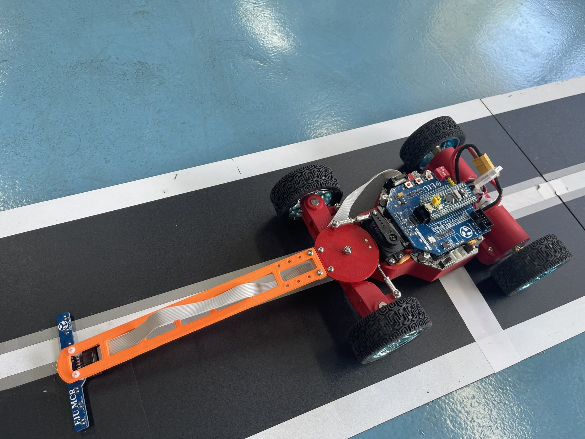

# 🏎️ EIU Micom Car Rally (MCR) Autonomous Racing Robot


## 📌 Overview
This repository contains the embedded firmware, custom PCB designs, and 3D mechanical CAD files for the **Autonomous Line-Following Racing Robot** developed at **Eastern International University (EIU)** for the **Micom Car Rally (MCR)** competition. 

The robot is engineered to autonomously navigate high-speed tracks featuring sharp corners, right-angle turns, lane changes, and crank obstacles using real-time optical sensor fusion and closed-loop PID control.

---

## ⚙️ Key Features
* **High-Speed Line Tracking:** Multi-channel phototransistor sensor array with dynamic calibration for varying ambient light conditions.
* **Rule-Based & State-Machine Steering:** Discrete steering angle mapping and velocity profiling tailored for straightaways, 90-degree turns, lane-change markers, and crank sections.
* **Custom High-Current Power Stage:** Dedicated self-designed motor driver PCB utilizing **BTS7960** half-bridge ICs to handle high stall currents and rapid acceleration of dual **GA25** DC gear motors.
* **Precision Front-Wheel Steering:** High-torque **MG996R** metal-gear servo actuated via hardware PWM timers for responsive cornering.

---

## 🛠️ System Architecture & Hardware Stack

| Subsystem | Component / Specification |
| :--- | :--- |
| **Microcontroller** | Custom Control Board featuring **ATmega2560** (16 MHz, 8-bit AVR) |
| **Firmware Toolchain** | **Atmel Studio** (Embedded C / AVR-GCC) |
| **Steering Actuator** | **MG996R** High-Torque Metal-Gear Servo |
| **Drive Motors** | Dual **GA25** Brushed DC Gear Motors |
| **Motor Driver** | Custom Power PCB with **BTS7960** High-Current H-Bridge Drivers |
| **Chassis & Mechanical** | Custom 3D-Modeled Chassis & Steering Linkage (**SolidWorks**) |
---
### Hardware & Mechanical Overview
| Assembled Robot |
| :---: |
| |

https://github.com/user-attachments/assets/2b1cdce1-1ee2-4539-871d-8eb3b522facf

## 📂 Repository Structure
```text
EIU-Micom-Car-Rally/
├── Firmware/               # Atmel Studio project & modular AVR C drivers
│   ├── ADC/                # Optical line-sensor analog/digital acquisition
│   ├── ENCODER/            # Wheel encoder pulse counting & distance tracking
│   ├── HANDLE/             # MG996R steering servo control & angle mapping
│   ├── RUN/                # Main track navigation & state-machine routines
│   ├── SPEED/              # PWM duty-cycle generation for BTS7960 motor drivers
│   ├── TIMER/              # Hardware timer & interrupt service routines
│   ├── LCD/ & LED/ & BEEP/ # On-board debugging UI, status indicators & buzzer
│   ├── EEPROM/             # Non-volatile storage for sensor calibration thresholds
│   └── EIU MCR.atsln       # Atmel Studio solution file
├── Hardware_PCB/           # Custom ATmega2560 control board & BTS7960 driver schematics
├── Mechanical_CAD/         # SolidWorks chassis assembly and 3D printable parts
└── README.md               
```
---


## 🔮 Future Improvements

* Implement closed-loop **PID control** for smoother high-speed steering transitions and differential motor speed regulation using GA25 encoder feedback.
* Add dynamic speed profiling based on upcoming track curvature.

---

## 👨‍💻 Author

**Hoàng Quốc Thái**

*Mechatronics Engineering Student — Eastern International University (EIU)*

* **GitHub:** [@Hoang-Quoc-Thai](https://github.com/Hoang-Quoc-Thai)
* **LinkedIn:** [linkedin.com/in/thaihoangg](https://www.google.com/search?q=https://www.linkedin.com/in/thaihoangg/)
